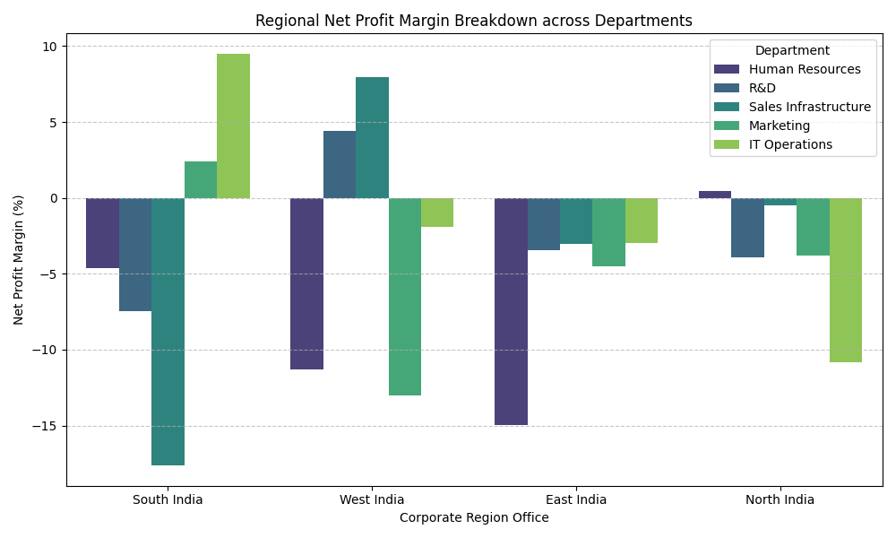

# Corporate Financial Operations & Performance Analytics Platform

## Project Overview

An end-to-end financial data analytics project engineering data pipelines to monitor corporate expenses, compute dynamic departmental net profit margins, and isolate operational cost leakages across geographic regional branches.

## Technical Stack Used

- **Data Processing & Pipeline Integration:** Python (Pandas, NumPy)
- **Statistical Performance Visualizations:** Seaborn, Matplotlib
- **Relational Database Querying:** SQL (Common Table Expressions, Financial Aggregations)

## Core Business Discoveries

- **Margin Profiling:** Identified specific regional branches running below the target 15% net profit margin thresholds due to inflated IT infrastructure operations costs.
- **Operational Expense Volatility:** Isolated transaction clusters where operating costs scaled faster than revenue milestones.

## Executive Profit Margin Analysis



## Primary SQL Execution Model

```sql
SELECT
    Department,
    ROUND((SUM(Revenue) - SUM(Operating_Cost)), 2) AS Absolute_Gross_Profit,
    ROUND(((SUM(Revenue) - SUM(Operating_Cost)) / SUM(Revenue)) * 100, 2) AS Profit_Margin_Pct
FROM corporate_financials
GROUP BY Department;
```
